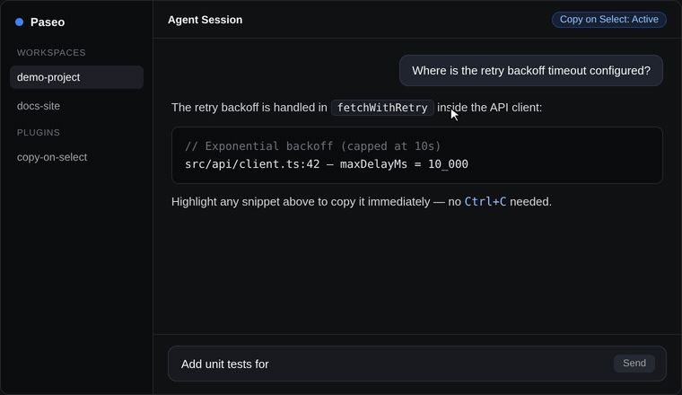

# paseo-copy-on-select

A Paseo plugin that automatically copies highlighted text to the clipboard when you release the mouse button (similar to copy-on-select in terminals and Claude Code).



## Install

```bash
paseo plugin add git:koh-murakami-ai/paseo-copy-on-select
```

## Behavior

- Copies non-empty text selections on primary mouse button release (`mouseup`).
- Ignores selections inside editable fields (`input`, `textarea`, `[contenteditable]`).
- Shows a brief `Copied` toast in the bottom-right corner on copy.
- Desktop (Electron) and web clients only; no daemon code or network requests.

## License

MIT
